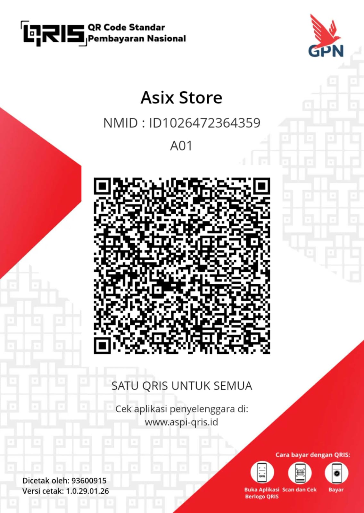

<!-- Typing SVG: Dynamic Intro -->

**Mobile Developer (Android & Cross-Platform)** 
📍 Based in Pangandaran, West Java, Indonesia 🇮🇩

<!-- Social & contact badges -->

  

<a href="#-about-me">About</a> ·
<a href="#-professional-services">Services</a> ·
<a href="#-tech-stack">Tech Stack</a> ·
<a href="#-professional-highlights">Highlights</a> ·
<a href="#-development-process">Process</a> ·
<a href="#-github-highlights">GitHub</a> ·
<a href="#-why-clients-choose-me">Why Me</a> ·
<a href="#-lets-work-together">Contact</a> ·
<a href="#-support-developer">Donate</a> ·
<a href="#-fun-facts">Fun Facts</a>

---

## 🌟 About Me

I'm a dedicated **Mobile Developer** with proven expertise in delivering high-quality Android and cross-platform applications. Graduated from **STMIK DCI**, I bring both technical excellence and business understanding to every project.

<table>
  <tr>
    <td width="50%" valign="top">
      <h4>🎁 What I Bring to Your Project</h4>
      <ul>
        <li>✅ <b>Professional experience</b> in mobile development with proven track record</li>
        <li>✅ <b>Professional-grade</b> Android apps (Kotlin/Java) with modern architecture</li>
        <li>✅ <b>Cross-platform expertise</b> in Flutter for iOS &amp; Android deployment</li>
        <li>✅ <b>Clean, maintainable code</b> following industry best practices</li>
        <li>✅ <b>Reliable delivery</b> with clear communication throughout development</li>
        <li>✅ <b>Post-launch support</b> and maintenance for seamless operations</li>
      </ul>
    </td>
    <td width="50%" valign="top">
      <h4>🎯 Current Focus</h4>
      <ul>
        <li>🔭 Developing <b>Enterprise &amp; Freelance Mobile Applications</b></li>
        <li>🛠️ Specializing in <b>Native Android (Kotlin/Java)</b> and <b>Flutter</b></li>
        <li>💡 Crafting <b>Intuitive UI/UX</b> with performance optimization</li>
        <li>🚀 Building <b>Scalable, Production-ready</b> mobile solutions</li>
        <li>📫 Available for projects at <b>khoirul.20998@gmail.com</b></li>
      </ul>
    </td>
  </tr>
</table>

---

## 💼 Professional Services

I offer comprehensive mobile development services tailored to your business needs:

<table>
  <tr>
    <td width="50%" valign="top">
      <h4>📱 Android Development</h4>
      <ul>
        <li>Native Android apps using <b>Kotlin</b> and <b>Java</b></li>
        <li>Modern architecture (MVVM, Clean Architecture)</li>
        <li>Material Design 3 implementation</li>
        <li>Integration with REST APIs, Firebase, and third-party SDKs</li>
        <li>Performance optimization and testing</li>
      </ul>
    </td>
    <td width="50%" valign="top">
      <h4>🚀 Flutter Development</h4>
      <ul>
        <li>Cross-platform apps for iOS and Android</li>
        <li>Single codebase, dual deployment</li>
        <li>Beautiful, responsive UI with custom widgets</li>
        <li>State management (Provider, Bloc, Riverpod)</li>
        <li>Native feature integration</li>
      </ul>
    </td>
  </tr>
  <tr>
    <td valign="top">
      <h4>🎨 UI/UX Implementation</h4>
      <ul>
        <li>Converting designs (Figma, Adobe XD) to pixel-perfect apps</li>
        <li>Smooth animations and transitions</li>
        <li>Responsive layouts for all screen sizes</li>
        <li>Accessibility compliance</li>
      </ul>
    </td>
    <td valign="top">
      <h4>🔧 App Maintenance &amp; Support</h4>
      <ul>
        <li>Bug fixes and performance improvements</li>
        <li>Feature additions and updates</li>
        <li>Play Store/App Store deployment</li>
        <li>Long-term maintenance contracts available</li>
      </ul>
    </td>
  </tr>
</table>

---

## 🧰 Tech Stack

  <!-- Skill Icons -->
  

 

| Category | Technologies |
|:---------|:-------------|
| 🗣️ **Languages** | Kotlin · Java · Dart · JavaScript · PHP |
| 🧱 **Frameworks** | Flutter · React Native · Android SDK |
| 🏗️ **Architecture** | MVVM · MVI · Clean Architecture · Repository Pattern |
| 🗄️ **Backend** | Firebase · RESTful APIs · MySQL · Room Database |
| 🧰 **Tools** | Android Studio · VS Code · Git · Docker · Postman |
| 🧪 **Testing** | JUnit · Espresso · Mockito · Flutter Test |
| ⚙️ **CI/CD** | GitHub Actions · GitLab CI · Fastlane |

---

## 🏆 Professional Highlights

<table>
  <tr>
    <td width="50%" valign="top">
      <h4>Technical Expertise</h4>
      <ul>
        <li>💻 <b>Mobile Development</b>: Android (Kotlin, Java) and Flutter (Dart)</li>
        <li>🏗️ <b>Architecture</b>: MVVM, Clean Architecture, Repository Pattern</li>
        <li>🔧 <b>Complex Integrations</b>: Payment gateways, real-time features, geo-location</li>
        <li>📱 <b>Full Lifecycle</b>: Design → Development → Testing → Deployment → Maintenance</li>
      </ul>
    </td>
    <td width="50%" valign="top">
      <h4>Experience Scope</h4>
      <ul>
        <li>🌍 <b>Geographic Reach</b>: Indonesia, ASEAN, International clients</li>
        <li>💼 <b>Industries</b>: E-commerce, Education, Healthcare, Finance, Startups</li>
        <li>🎯 <b>App Types</b>: Enterprise solutions, B2C applications, Cross-platform apps</li>
        <li>⚙️ <b>Development Approach</b>: Agile methodology, Clean code, Best practices</li>
      </ul>
    </td>
  </tr>
</table>

---

## 🛠️ Development Process

I follow a structured, transparent development workflow to ensure quality results:

| Step | Phase | What Happens |
|:----:|:------|:-------------|
| 1 | 📋 **Discovery & Planning** | • Requirements gathering and analysis • Technical feasibility assessment • Timeline and milestone planning |
| 2 | 🎨 **Design & Prototyping** | • UI/UX design review and feedback • Prototype development for key features • Design system creation |
| 3 | 💻 **Development** | • Agile/Scrum methodology • Regular progress updates (daily/weekly) • Code reviews and quality checks • Version control with Git |
| 4 | 🧪 **Testing & QA** | • Unit and integration testing • Manual QA on multiple devices • Performance and security testing • Bug fixing and refinement |
| 5 | 🚀 **Deployment & Launch** | • Play Store/App Store submission • Production deployment assistance • Launch monitoring |
| 6 | 📞 **Support & Maintenance** | • Post-launch support • Performance monitoring • Feature updates and enhancements |

---

## 📊 GitHub Highlights

  <!-- Repository Count -->
  
  <!-- Total Stars -->
  
  <!-- Activity / Last Commit -->
  

---

## 💬 Why Clients Choose Me

<table>
  <tr>
    <td width="50%" valign="top">
      <h4>Professional Approach</h4>
      <ul>
        <li>🎯 <b>Clear Communication</b>: Regular updates and transparent progress tracking</li>
        <li>📊 <b>Quality Focus</b>: Clean, well-documented code following best practices</li>
        <li>⏰ <b>Reliable Delivery</b>: Realistic timelines with milestone-based approach</li>
        <li>🤝 <b>Collaborative</b>: Open to feedback and iterative improvements</li>
        <li>🔒 <b>Confidentiality</b>: NDA-ready and respectful of proprietary information</li>
        <li>📈 <b>Long-term Thinking</b>: Building scalable solutions for future growth</li>
      </ul>
    </td>
    <td width="50%" valign="top">
      <h4>Client-Centric Values</h4>
      <ul>
        <li>Understanding business goals, not just technical requirements</li>
        <li>Proactive problem-solving and suggesting improvements</li>
        <li>Post-launch support and maintenance availability</li>
        <li>Knowledge transfer and documentation</li>
      </ul>
    </td>
  </tr>
</table>

---

## 📫 Let's Work Together!

I'm always interested in taking on new challenges and helping businesses succeed with mobile technology.

<table>
  <tr>
    <td width="50%" valign="top">
      <h4>💼 Available for</h4>
      <ul>
        <li>✅ Full-time remote positions</li>
        <li>✅ Freelance projects (short &amp; long-term)</li>
        <li>✅ Contract work</li>
        <li>✅ Technical consulting</li>
      </ul>
    </td>
    <td width="50%" valign="top">
      <h4>📧 Get in Touch</h4>
      <ul>
        <li>Email: <b>khoirul.20998@gmail.com</b></li>
        <li>GitHub: <a href="https://github.com/shirokun20">@shirokun20</a></li>
        <li>Location: Pangandaran, West Java, Indonesia 🇮🇩</li>
        <li><b>⚡ Quick Response</b>: I aim to respond promptly to all inquiries</li>
      </ul>
    </td>
  </tr>
</table>

---

## ☕ Support Developer

If you love **Shirokun** and want to support its development, you can buy me a coffee! ☕ 
Scan the QRIS below to donate:

  

> [!NOTE]
> Your support helps keep the servers running and the updates coming! 🚀

---

## ✨ Fun Facts

| | |
|:--|:--|
| 🧩 **Puzzle Solver** | I love coding challenges and logic puzzles. |
| 🏞️ **Explorer** | Outside coding, I enjoy exploring nature and local culture in Pangandaran. |
| 🎵 **Music Lover** | Music is my productivity fuel. |
| 📚 **Continuous Learner** | Always exploring new technologies and best practices. |
| 🌱 **Community Contributor** | Active in developer communities and open source. |

---

**Let's Connect & Collaborate!**

*Building the future, one line of code at a time.*

 

